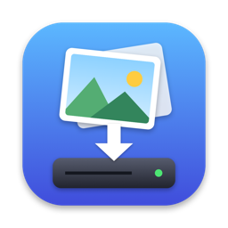
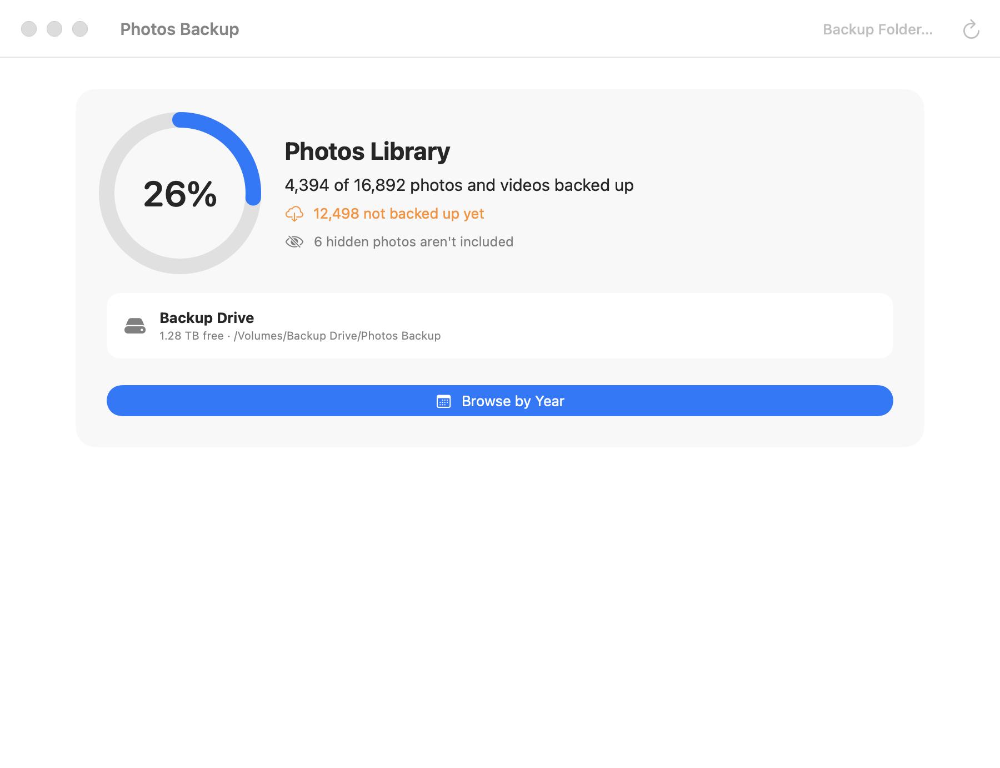
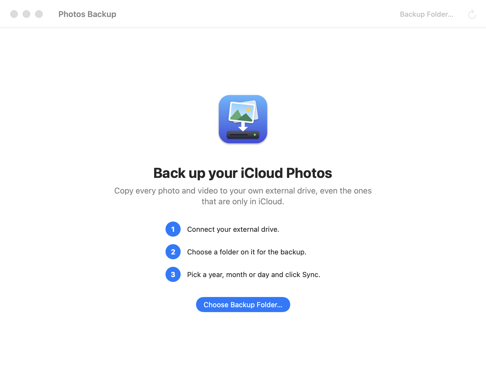
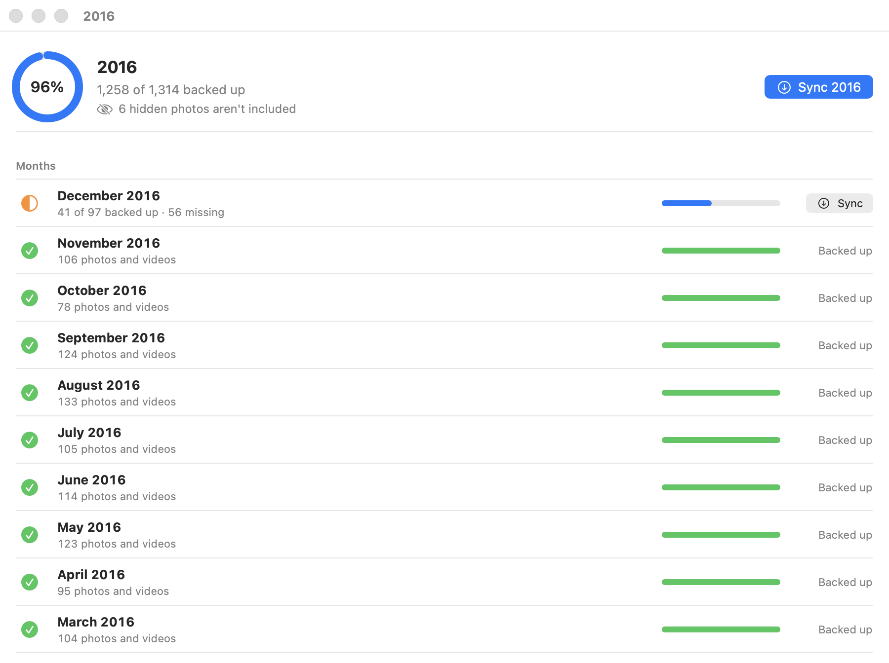
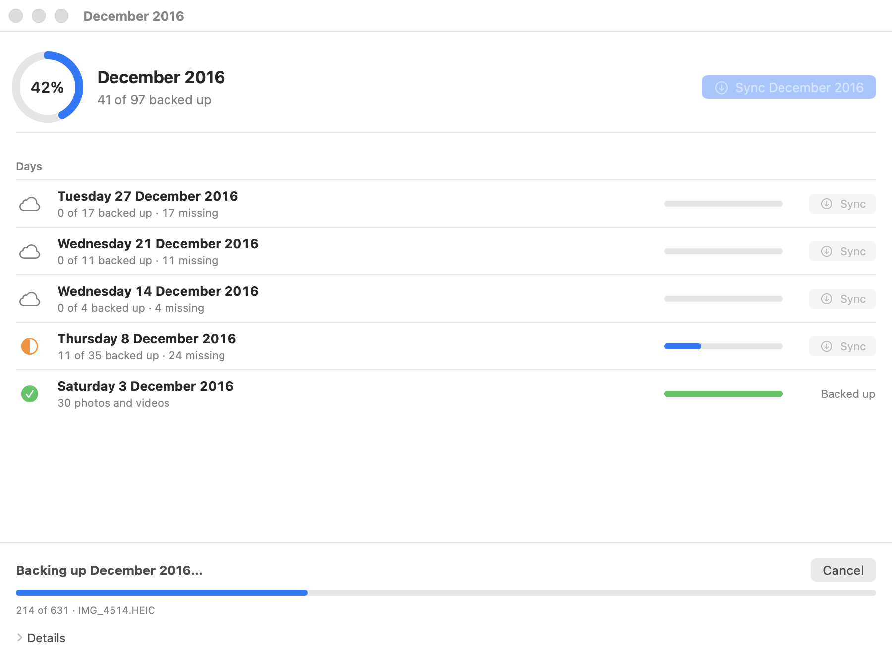
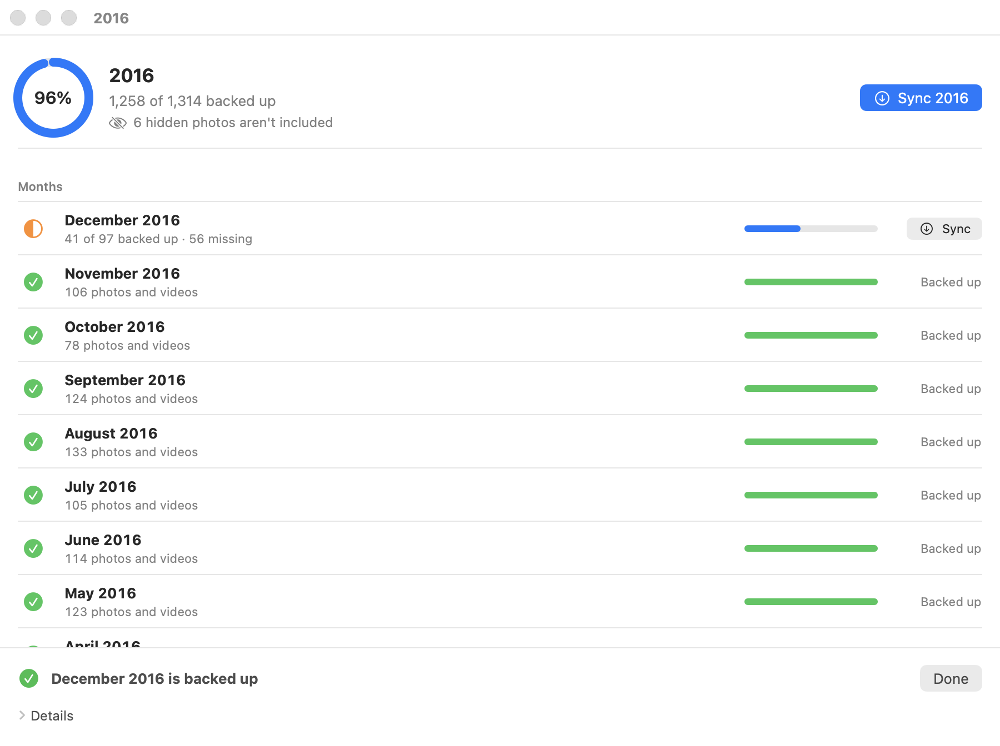
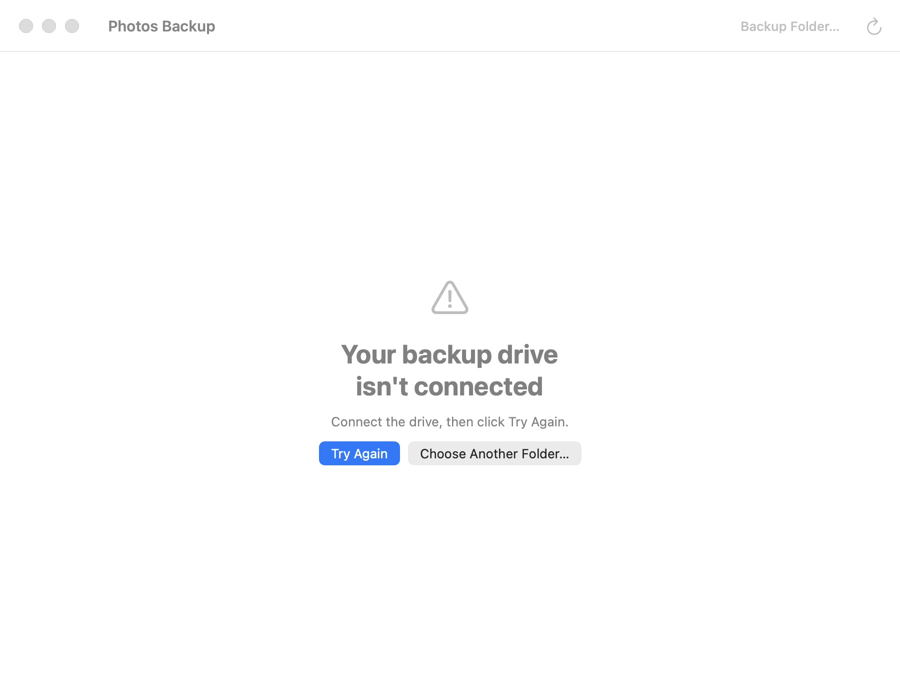

<p align="center"></p>

<h1 align="center">Photos Backup Tracker</h1>

<p align="center">Make your own copy of every photo and video in iCloud, on an external drive you own.</p>

<p align="center"></p>

---

## What it does

If you use iCloud Photos with **Optimize Mac Storage**, most of your photos aren't actually on your Mac. They
live in iCloud, and your Mac only keeps small previews. That's great for saving space, but it means you don't
have a copy of your own.

Photos Backup Tracker fixes that. It copies your photos and videos, originals included, onto an external
drive, sorted into folders by year, month and day. It shows you exactly how much is backed up, and you can
back up a year, a month or a single day with one click.

- **Your Mac doesn't fill up.** Photos are copied to the drive a bit at a time, never all onto your Mac.
- **Nothing is deleted.** The app only copies. It never removes or changes anything in Photos or iCloud.
- **You can stop any time.** Whatever was copied stays on the drive. Next time it continues where it left off.
- **Private.** Everything happens on your Mac, between Apple's Photos app and your drive.

## What you need

- A Mac with **Apple silicon** (M1, M2, M3, M4 or later). Not sure? Click the Apple menu  → **About This
  Mac** and look at "Chip".
- **macOS 14 Sonoma** or newer.
- **iCloud Photos** turned on in the Photos app.
- An **external drive** with enough free space for your library. The app shows how many photos and videos you
  have; as a rough guide, 10,000 photos take about 30–50 GB, and videos take more.

## Download and install

1. Go to the [**latest release**](../../releases/latest) and download the file ending in **`.dmg`**
   (for example `Photos-Backup-Tracker-0.1.0-arm64.dmg`).
2. Open the downloaded file. A window appears with the app and an **Applications** folder.
3. **Drag Photos Backup Tracker onto the Applications folder.**
4. Close the window, then eject the disk image: in Finder, click the ⏏ next to "Photos Backup Tracker" in the sidebar.

### Opening it for the first time

Photos Backup Tracker is a free, open-source project. It isn't registered with Apple, so the first time you
open it, macOS warns that it **couldn't verify the app**. That's expected. To allow it:

1. Open **Applications** and double-click **Photos Backup Tracker**. When the warning appears, click **Done**.
2. Open **System Settings** → **Privacy & Security**.
3. Scroll down to the **Security** section. Next to *"Photos Backup Tracker" was blocked*, click **Open Anyway**.
4. Confirm with your password or Touch ID, then click **Open**.

You only need to do this once. After that the app opens normally from Applications, Launchpad or Spotlight.

## How to use it

### 1. Connect your drive and choose a backup folder

Plug in your external drive. In Finder, open the drive and create a folder for the backup with **File → New
Folder**. Call it something like *Photos Backup*.

The first time you open the app, it asks you to choose that folder. Click **Choose Backup Folder…**, select the
folder on your drive, then click **Open**. The app remembers it. To use a different folder later, click
**Backup Folder…** at the top of the window.

<p align="center"></p>

macOS then asks whether the app may access your **Photos** and your **external drive**. Click **Allow** both
times. The app needs both to copy photos from one to the other.

### 2. See how much is backed up

The main window compares your Photos library with the backup folder. The first time this takes a minute or
two; later it's quicker.

- The **ring** shows how much of your library is on the drive.
- **"4,394 of 16,892 photos and videos backed up"** gives the exact numbers. The orange line below tells you
  how many are still missing.
- The **drive box** shows which drive the backup is on and how much space is left on it.

Click **Browse by Year** to see more.

### 3. Find what's missing

You see every year with its own count and progress bar. Click a year to see its months, and a month to see its
days.

<p align="center"></p>

The icon in front of each year, month or day tells you where it stands:

| Icon | Meaning |
|---|---|
| ✅ green check, green bar | Everything from that period is on the drive |
| 🌗 orange half circle, blue bar | Partly backed up. The grey text says how many are missing |
| ☁️ cloud, empty bar | Not backed up yet |

### 4. Back it up

Click **Sync** next to any year, month or day that isn't finished. The big blue **Sync** button at the top
backs up the whole period you're looking at, for example all of 2016.

<p align="center"></p>

While it works, the bar at the bottom shows how far it is and which photo it's copying. Photos that are only
in iCloud are downloaded first, so some take longer than others.

- **Cancel** stops after the current photo. Everything copied so far stays on the drive; click **Sync** again
  later to carry on.
- **Details** shows the full record of what's happening, which is useful if something goes wrong.
- Only one backup runs at a time. You can keep browsing while it runs.

When it's finished you see a green check. Click **Done**, and the counts update.

<p align="center"></p>

### How long does it take?

It depends on your internet connection and on how many photos are only in iCloud. As a rough idea, a month of
a few hundred photos takes minutes, and a whole year can take hours. Start with one month to see how fast it is
for you.

- Keep your Mac **plugged in and awake** during long backups. A sleeping Mac pauses the backup.
- Keep the **drive connected** until it finishes.
- You can use your Mac normally meanwhile, but it's best not to edit photos in Photos while a backup runs.

## Keeping your backup up to date

New photos aren't copied automatically. Every few weeks, or after a holiday:

1. Connect the drive and open Photos Backup Tracker.
2. The main window shows how many photos are missing.
3. Click **Browse by Year**, open the current year and click **Sync** on the months that aren't green.

Only the new photos are copied. Everything already on the drive is skipped.

## If something goes wrong

**"Your backup drive isn't connected"**

<p align="center"></p>

Plug the drive in and click **Try Again**. If you renamed the drive or moved the folder, click **Choose Another
Folder…** and select it again.

**"Choose a folder on an external drive"**
The backup has to go on an external drive, not on your Mac, so that your Mac doesn't fill up. Choose a folder on
the drive instead.

**"Couldn't find your Photos library"**
Open the Photos app once, so macOS knows where your library is, then click **Try Again**.

**The app says there isn't enough space on the Mac**
While copying, Photos keeps each downloaded photo on your Mac until macOS clears the space by itself. If your
Mac is low on space, the app won't start a big backup. Back up a single month instead, or wait a while and try
again.

**A backup "didn't finish"**
Click **Details** to see what happened. Usually the drive was unplugged, the Mac went to sleep or the internet
dropped. Click **Sync** again: it continues where it stopped and copies nothing twice.

**I clicked "Don't Allow" by mistake**
Open **System Settings** → **Privacy & Security**:

- under **Photos**, turn **Photos Backup Tracker** on;
- under **Files & Folders**, turn on **Removable Volumes** for Photos Backup Tracker.

Then quit and reopen the app.

**The app won't open at all**
Follow [Opening it for the first time](#opening-it-for-the-first-time) again. After installing a new version,
macOS asks once more.

## Where are my photos?

In the folder you chose, inside **Photos Library**, sorted by date:

```
Photos Backup/
├── Photos Library/
│   └── 2025/
│       └── 07/
│           └── 04/
│               ├── IMG_0001.HEIC         the photo itself, at full quality
│               ├── IMG_0001.mov          the video part of a Live Photo
│               └── IMG_0001_edited.jpeg  your edited version, if you edited it in Photos
└── photos-backup-logs/                   a record of every backup
```

These are normal files that open in Preview or any other app, and you can browse them in Finder. Older photos are
often JPEG instead of HEIC, because iPhones only started using HEIC in 2017. Every frame of a burst is included.
Each photo keeps its date, location and camera details.

**To bring photos back into Photos**, drag the folders you want onto the Photos app or into its window.

## Questions

**Does it delete anything from my iPhone, iCloud or Photos?**
No. It only reads from Photos and copies to your drive. It refuses to run in any mode that could delete or
change files.

**Do I have to back up everything at once?**
No. Back up whatever you like, whenever you like. The app always shows what's still missing.

**Why aren't my hidden photos backed up?**
Photos keeps the **Hidden** album locked, and doesn't hand those photos to any other app, this one included. The app
shows how many there are, for example *"51 hidden photos aren't included"*, and doesn't count them as missing. To
back them up, open the **Hidden** album in Photos, select the photos, choose **Image → Unhide Photo**, click **Sync** in
Photos Backup Tracker, then hide them again. Once they're on the drive they stay there.

**What about photos people sent me in Messages?**
Photos shows them under **Shared with You**, but they only become part of your library when you save them
(**Add to Library**). Saved ones are backed up like any other photo; unsaved ones aren't counted.

**Can I use the same drive for other things?**
Yes. The app only works inside the folder you chose.

**Are albums and people names saved?**
No. Only the photos and videos themselves, with their dates and locations, are copied. Albums, people names and
favourites stay in the Photos app.

**Can I back up to several drives?**
Yes. Click **Backup Folder…** and choose a folder on the other drive. Each folder keeps track of its own backup.

**How do I update the app?**
Download the newest `.dmg` from the [releases page](../../releases) and drag the app into Applications again,
choosing **Replace**. macOS may ask for its permissions again.

**How do I remove it?**
Drag Photos Backup Tracker from Applications to the Trash. Your backup on the drive stays where it is.

## For developers

Photos Backup Tracker is open source under the [MIT license](LICENSE). It has a native SwiftUI app and a Python
command-line tool built on [osxphotos](https://github.com/RhetTbull/osxphotos), which can also be used on its
own. See [CONTRIBUTING.md](CONTRIBUTING.md) for building from source, the command-line tool, tests and
releasing, and [architecture.md](architecture.md) for how it fits together. The screenshots above are generated
from demo data with `make screenshots`.
